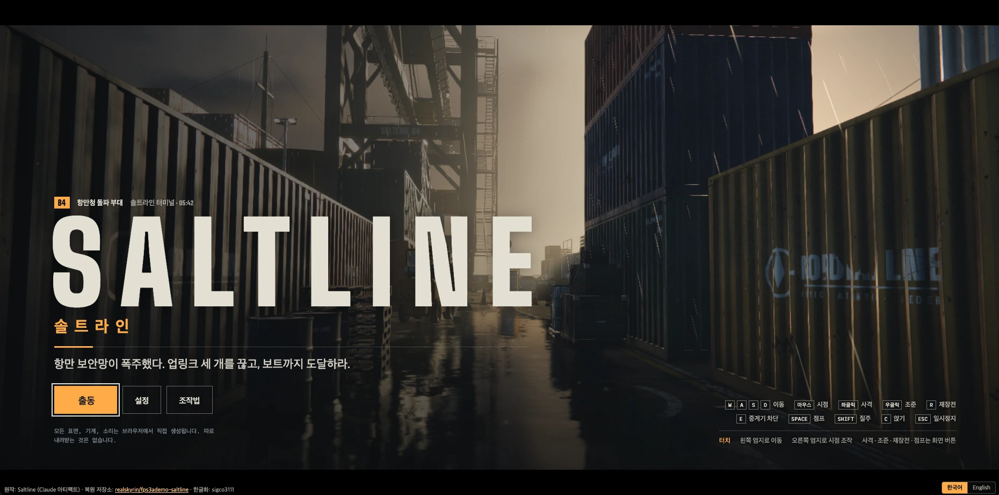
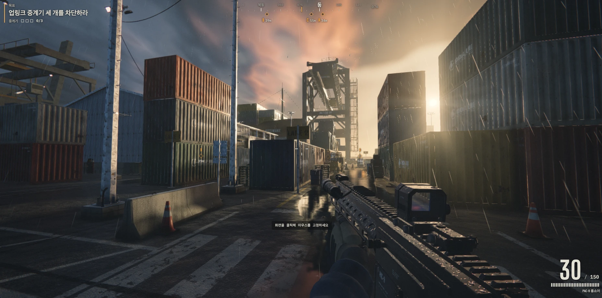
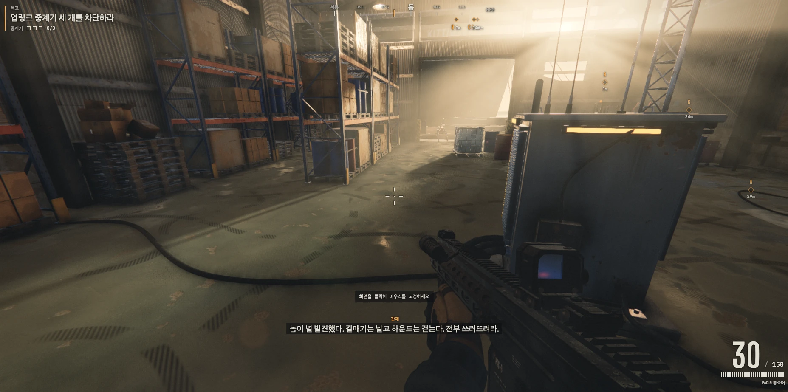
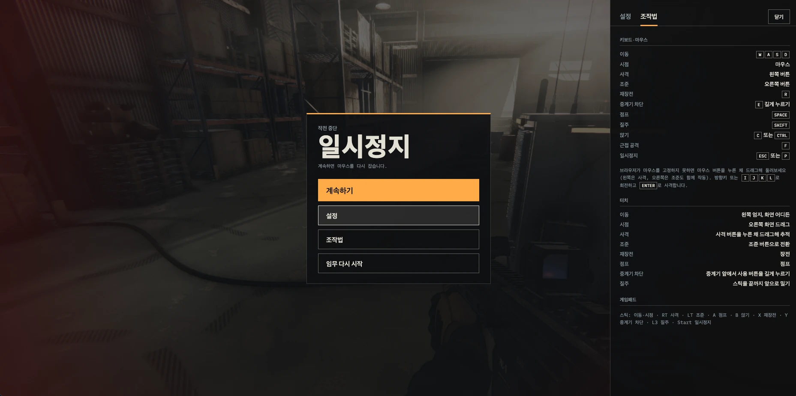
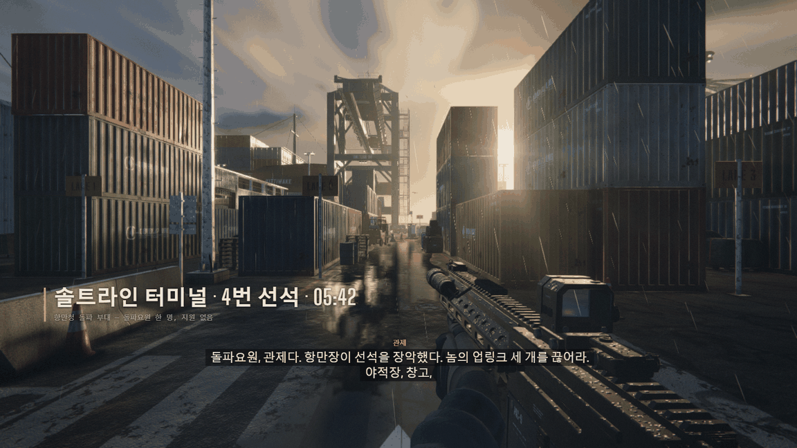
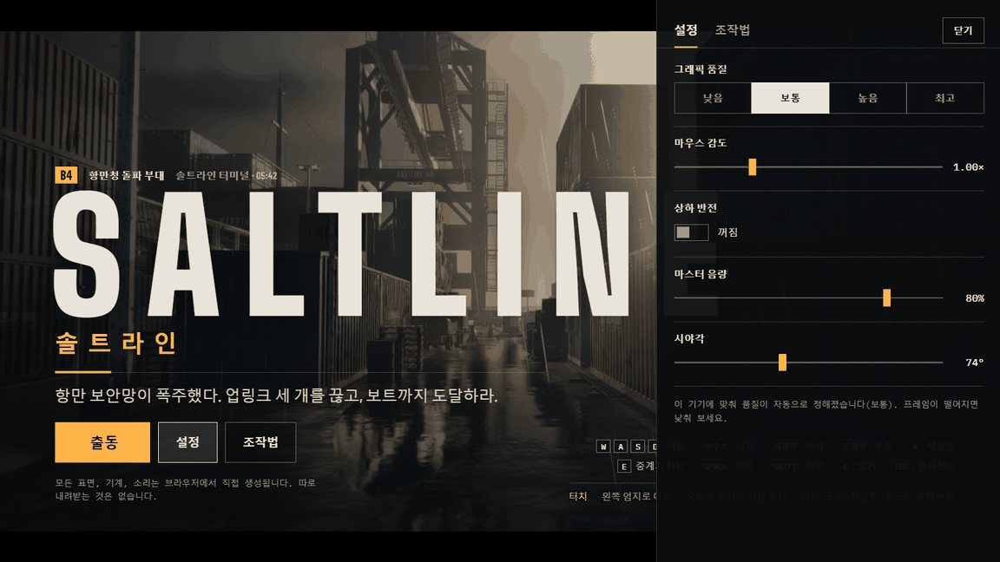
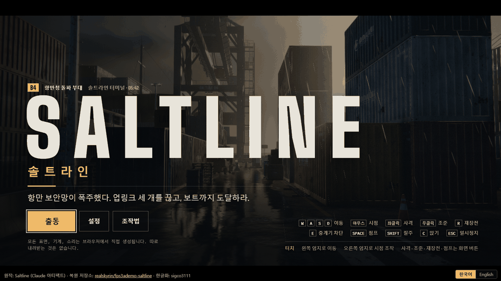

<h1 align="center">솔트라인 (Saltline) 한글화</h1>

<p align="center">항만 보안망이 폭주한 4번 선석에서 업링크 중계기 세 개를 끊고 보트까지 탈출하는, 브라우저 1인칭 슈터 <b>Saltline</b>의 비공식 한글화판입니다.</p>

<p align="center"><b>▶ 바로 플레이: <a href="https://sigco3111.github.io/saltline-ko/">https://sigco3111.github.io/saltline-ko/</a></b> (<b>출동</b> 버튼으로 시작)</p>

> 이 저장소는 비영리 팬 한글화이며 원작자와 무관한 비공식 작업입니다. 아래 [라이선스·원작 표기](#라이선스원작-표기)를 꼭 확인해 주세요.

## 프로젝트 소개

Saltline은 Claude 아티팩트로 공개된 브라우저 게임입니다. 플레이어는 돌파요원 한 명이 되어 항만청 돌파 부대의 임무(솔트라인 터미널 · 4번 선석)를 수행합니다. 관제의 무전을 들으며 야적장, 창고, 부두에 있는 업링크 중계기 세 개(A, B, C)를 끊고, 부두 남쪽 끝 사다리에 대기한 보트까지 도달하면 임무가 끝납니다.

이 저장소는 그 게임의 화면 문자열을 한국어로 옮긴 **빌드 결과물**과 배포 파일을 담고 있습니다. 게임 규칙, 렌더링, 물리, 소리 등 게임플레이 코드는 바꾸지 않았습니다.

**목표**

1. 야적장, 창고, 부두의 업링크 중계기 세 개에 다가가 **E를 길게 눌러** 차단합니다.
2. 중계기를 끊을 때마다 기계(갈매기는 비행형, 하운드는 보행형)가 더 몰려옵니다.
3. 세 개를 모두 끊으면 부두 남쪽 끝 사다리의 보트로 달려가 탈출합니다.

## 주요 기능

- **한국어 UI 전체**: 타이틀, 일시정지, 사망, 결과 화면, 설정·조작법 패널, HUD(목표, 중계기, 체력, 탄약, 방위 표시), 관제 무전 자막, 안내 메시지, 터치 버튼, 로딩 문구, 오류 메시지까지 번역했습니다. 번역 문자열은 사전 항목 148개와 함수형 6개(`holdPrompt`, `cutRelayPrompt`, `remaining`, `contact`, `qualityAuto`, `destroyed`)로, 번들에서 센 값이 모두 **154개**입니다.
- **한국어/영어 전환**: 화면 오른쪽 아래의 `한국어 / English` 버튼(일부 화면에서만 표시)이나 주소의 `?lang=` 으로 바꿀 수 있습니다. 규칙은 [기술 내용](#기술-내용)에 있습니다.
- **설치 없이 실행**: 지형, 질감, 기계, 소리를 모두 브라우저에서 직접 생성합니다. 게임 안에서 따로 내려받는 파일이 없고 글꼴도 저장소에 포함되어 있습니다.
- **PC, 터치, 게임패드 지원**: 원작의 입력 방식을 그대로 유지합니다.
- **설정**: 그래픽 품질(낮음·보통·높음·최고), 마우스 감도, 상하 반전, 마스터 음량, 시야각. 브라우저 `localStorage`에 저장됩니다.

### 조작법

| 동작 | 키 |
| --- | --- |
| 이동 / 시점 | WASD / 마우스 |
| 사격 / 조준 | 마우스 왼쪽 / 오른쪽 버튼 |
| 재장전 / 근접 공격 | R / F |
| 점프 / 질주 | Space / Shift |
| 앉기 | C 또는 Ctrl |
| 중계기 차단 | 중계기 근처에서 E 길게 누르기 |
| 일시정지 | Esc 또는 P |

- 브라우저가 마우스를 고정하지 못하면 마우스 버튼을 누른 채 드래그해 둘러볼 수 있습니다. 방향키 또는 IJKL로 회전하고 Enter로 사격합니다.
- 터치: 왼쪽 엄지로 이동, 오른쪽 화면 드래그로 시점 조작, 화면의 사격·조준·장전·점프·사용 버튼을 씁니다.
- 게임패드: 스틱 이동·시점, RT 사격, LT 조준, A 점프, B 앉기, X 재장전, Y 중계기 차단, L3 질주, Start 일시정지.

## 실행 화면

앞의 네 장은 제작자가 자기 컴퓨터에서 직접 찍은 한국어 화면입니다(약 1860×920, WebP). 뒤의 세 장은 클라우드 브라우저에서 찍은 1152×648 화면입니다.

<p align="center">
  <br>
  <sub><b>타이틀 화면</b> — SALTLINE 로고와 <code>솔트라인</code> 부제, 슬로건, 출동·설정·조작법 버튼, 오른쪽 아래 키보드·터치 조작 안내, 아래쪽 원작 표기 푸터와 한국어/English 전환 버튼</sub>
</p>

<p align="center">
  <br>
  <sub><b>플레이 화면(야적장)</b> — 왼쪽 위 목표 &quot;업링크 중계기 세 개를 차단하라&quot;와 중계기 0/3, 위쪽 방위 표시와 중계기 위치·거리, 오른쪽 아래 탄약 30/150과 무기 이름, 가운데 &quot;화면을 클릭해 마우스를 고정하세요&quot; 안내</sub>
</p>

<p align="center">
  <br>
  <sub><b>창고 안</b> — 선반과 상자가 쌓인 실내에서 같은 HUD(목표, 방위 표시, 탄약 30/150)와 아래쪽 관제 무전 자막 &quot;놈이 널 발견했다. 갈매기는 날고 하운드는 걷는다. 전부 쓰러뜨려라.&quot;</sub>
</p>

<p align="center">
  <br>
  <sub><b>일시정지와 조작법</b> — 가운데 <code>일시정지</code> 카드(계속하기·설정·조작법·임무 다시 시작)와 오른쪽 조작법 패널(키보드·마우스, 터치, 게임패드)</sub>
</p>

<p align="center">
  <br>
  <sub><b>임무 시작</b> — 장소 카드(솔트라인 터미널 · 4번 선석 · 05:42)와 관제 무전 자막. 클라우드 캡처</sub>
</p>

<p align="center">
  <br>
  <sub><b>설정 패널</b> — 그래픽 품질, 마우스 감도, 상하 반전, 마스터 음량, 시야각. 클라우드 캡처</sub>
</p>

<p align="center">
  <br>
  <sub><b>타이틀 화면(작은 해상도)</b> — 위 타이틀 화면과 같은 장면을 1152×648로 찍은 것. 클라우드 캡처</sub>
</p>

## 설치·실행 방법

### 바로 플레이

https://sigco3111.github.io/saltline-ko/ 를 열고 **출동**을 누릅니다. WebGL 2를 지원하는 브라우저(Chrome, Edge 등)를 권장합니다.

### 내 컴퓨터에서 실행

이 저장소는 빌드 결과물이라 설치할 패키지가 없습니다. 스크립트가 ES 모듈이므로 `index.html`을 더블클릭해 열지 말고 정적 HTTP 서버로 여세요.

```sh
git clone https://github.com/sigco3111/saltline-ko.git
cd saltline-ko
python3 -m http.server 8000
```

브라우저에서 http://127.0.0.1:8000/ 을 열면 됩니다. 한국어로 강제하려면 `http://127.0.0.1:8000/?lang=ko` 로 엽니다. 정적 파일만 서비스하면 되므로 다른 서버를 써도 무방합니다.

### 다시 빌드하려면

이 저장소에는 `src`, `package.json`, Vite 설정이 없어 여기서 다시 빌드할 수 없습니다. 원작 저장소는 Vite 8.3.7로 빌드하며 Node.js `^20.19.0 || >=22.12.0`이 필요하고 `npm run dev`, `build`, `preview`, `check` 스크립트를 제공합니다. 자세한 내용은 [원작 저장소](https://github.com/realskyrin/fps3ademo-saltline)의 README(중국어)를 보세요.

## 기술 내용

- **구성**: `index.html`, `assets/saltline.js`(게임과 번역 사전을 담은 번들), `assets/index.css`, `fonts/`(woff2 글꼴 22개), `licenses/`(제3자 라이선스 원문)로 이루어진 정적 사이트입니다.
- **엔진**: Three.js r180(번들에 포함, `REVISION` 180)로 WebGL 렌더링. 원작은 Vite 8.3.7로 번들합니다.
- **외부 의존**: 원작 README는 Claude, Google Fonts 등 온라인 서비스나 API 키가 필요 없다고 밝히고 있습니다. 이 한글화판의 실행 중 네트워크 요청이 0건인지는 따로 측정하지 않았습니다.
- **언어 판별 규칙**
  1. 주소에 `?lang=ko` 또는 `?lang=en`(앞부분 일치, 대소문자 무시)이 있으면 그 언어를 쓰고 `localStorage`의 `saltline.lang`에 저장합니다.
  2. 없으면 `localStorage`에 저장된 값을 씁니다.
  3. 저장된 값이 없으면 `navigator.languages`가 `ko`로 시작할 때 한국어, 아니면 영어(원작 언어)입니다.
  4. 게임 안의 `한국어 / English` 버튼은 선택을 저장하고 `?lang` 없이 페이지를 다시 불러옵니다. 전환하면 진행 중인 판은 처음부터 시작합니다.
- **문서 제목**: 한국어 모드에서 `솔트라인 (Saltline)`로 바뀝니다. 화면 아래에는 `원작: Saltline (Claude 아티팩트) · 복원 저장소: realskyrin/fps3ademo-saltline · 한글화: sigco3111` 표기가 나옵니다.
- **글꼴**: 한글은 `Noto Sans KR`, `Malgun Gothic`, `Apple SD Gothic Neo` 시스템 글꼴 순서로 표시합니다. 영문 글꼴(Barlow Condensed, Big Shoulders Display, IBM Plex Mono)은 `fonts/`에 로컬로 포함되어 있습니다.
- **번역하지 않은 것**: 컨테이너 표지, 무기 각인, 안전 명판처럼 3D 장면의 질감에 그려진 영문 장식 문구는 소품이므로 그대로 두었습니다. 개발자용 콘솔 로그와 벤치마크 모드 표시도 그대로입니다.
- **파일 이름**: GitHub 웹 업로드가 파일 이름을 소문자로 바꾸므로 빌드 산출물과 글꼴 파일 이름은 소문자로 맞춰져 있습니다.

## 라이선스·원작 표기

- **원작 게임**: Saltline (Claude 아티팩트로 공개된 브라우저 게임, <https://claude.ai/artifact/BGY1SztrAYcJQHSsnHHGmp>). 원작자는 확인하지 못했습니다.
- **복원 저장소**: <https://github.com/realskyrin/fps3ademo-saltline>. 위 아티팩트를 복원해 Vite 기반 ES 모듈로 다시 구성한 저장소이며 README는 중국어입니다. 이 한글화는 커밋 `27fec5fe972c22d79440e9b5670b9590f8b3c13a` (`Add gameplay screenshots near the top of README`) 기준입니다. 원본 데모: <https://realskyrin.github.io/fps3ademo-saltline/>
- **라이선스 상태**: 한글화 작업일(**2026-11-11**) 기준으로 원본 저장소에는 `LICENSE` 파일이 없었고 원작 코드의 라이선스는 명시되어 있지 않았습니다. 이 저장소는 원작 코드에 대해 어떤 라이선스도 부여하지 않으며, 저장소 전체에 적용되는 `LICENSE` 파일도 두지 않았습니다. 원작 부분의 권리는 각 권리자에게 있습니다.
- **성격과 삭제 요청**: 이 저장소는 **비영리 팬 한글화**이며 원작자에 대한 존중을 담아 공개합니다. 권리자께서 요청하시면 **즉시 내리겠습니다**. 이 저장소의 Issues로 알려 주세요.
- **제3자 라이선스**: 아래 라이선스는 `licenses/` 폴더에 원문 그대로 두었으니 폴더를 지우거나 고치지 마세요.
  - Three.js r180 — MIT (`licenses/three-r180-MIT.txt`)
  - Barlow Condensed, Big Shoulders Display, IBM Plex Mono — SIL Open Font License (`licenses/barlowcondensed-OFL.txt`, `licenses/bigshouldersdisplay-OFL.txt`, `licenses/ibmplexmono-OFL.txt`)

### 수정 내역

원본 저장소 커밋 `27fec5f` 대비 변경점입니다. 이 저장소에는 빌드 결과물만 있으므로 아래는 원본의 소스 파일 기준으로 적었습니다. 배포 파일은 변경한 소스를 `vite build`(`base: './'`)로 빌드한 결과물입니다.

- `src/i18n.js` 추가: 언어 판별(`?lang=` → `localStorage` → 브라우저 언어), 한국어 문자열 사전, 언어 전환 버튼, 한국어 출처 표기 푸터.
- `src/ui/menus.js`, `src/ui/hud.js`, `src/game/flow.js`, `src/input/input.js`, `src/app/boot-screen.js`, `src/app/diagnostics.js`: 화면 문자열을 사전 조회(`_t()`) 방식으로 바꿈. 한국어 문장 구조가 달라지는 몇 곳(중계기 차단 안내, 남은 중계기 수, 적 발견 경고, 처치 알림, 품질 안내)은 함수형 번역을 사용.
- `src/ui.css`: 한글 글꼴 스택, 한글용 자간 조정, 전환 버튼과 푸터 스타일. 둘은 로딩·타이틀·일시정지·결과 화면에서만 보이고 플레이 중에는 숨김.
- `src/game.js`: `i18n.js`를 가장 먼저 불러오도록 한 줄 추가.
- `vite.config.js`, `src/fonts.css`, `public/fonts/`: 빌드 산출물(`assets/saltline.js`, `assets/index.css`)과 글꼴 파일 이름을 소문자로 고정하고 소스맵을 끔.
- 한국어 UI에서는 타이틀에 `솔트라인` 부제를 추가.
